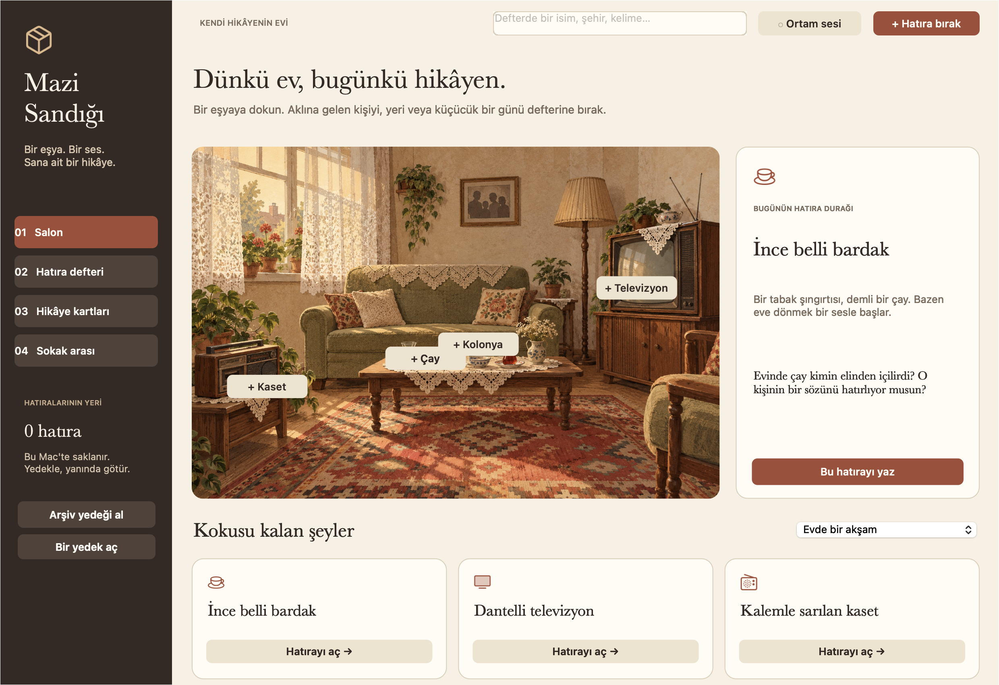
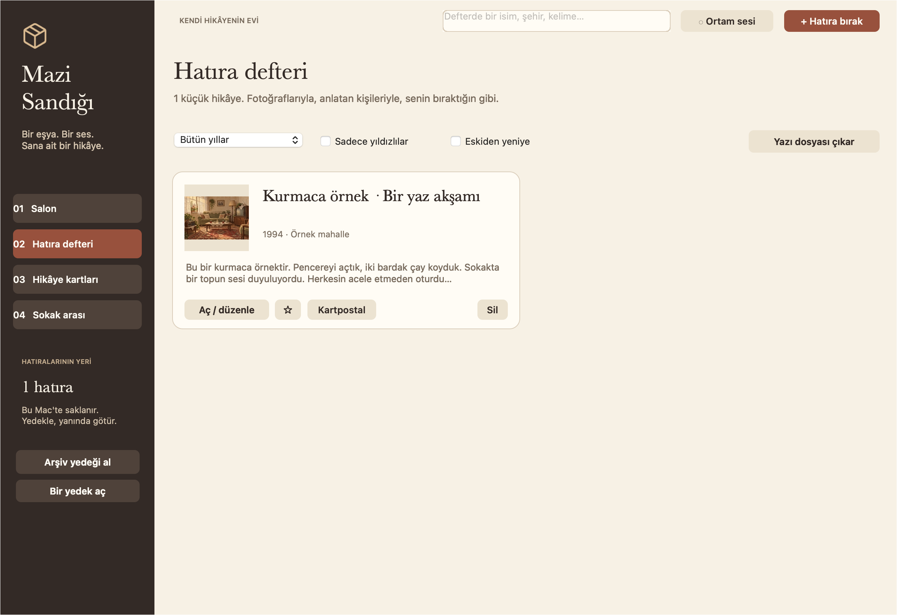
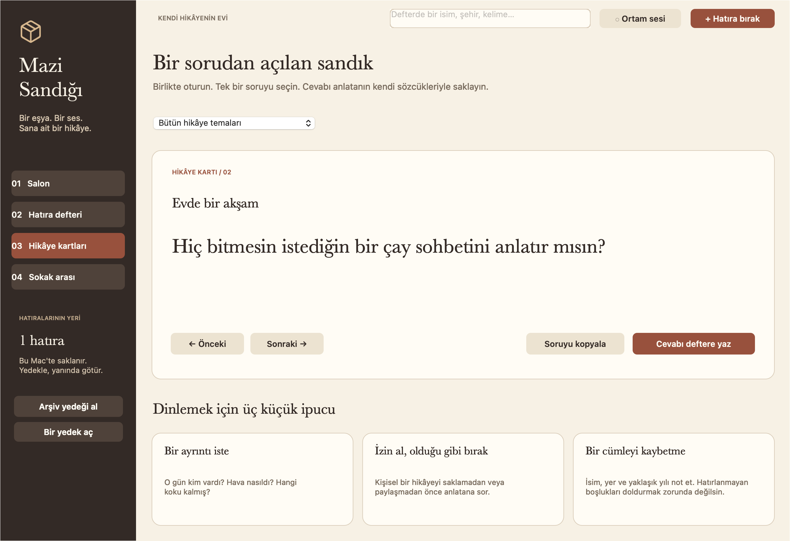
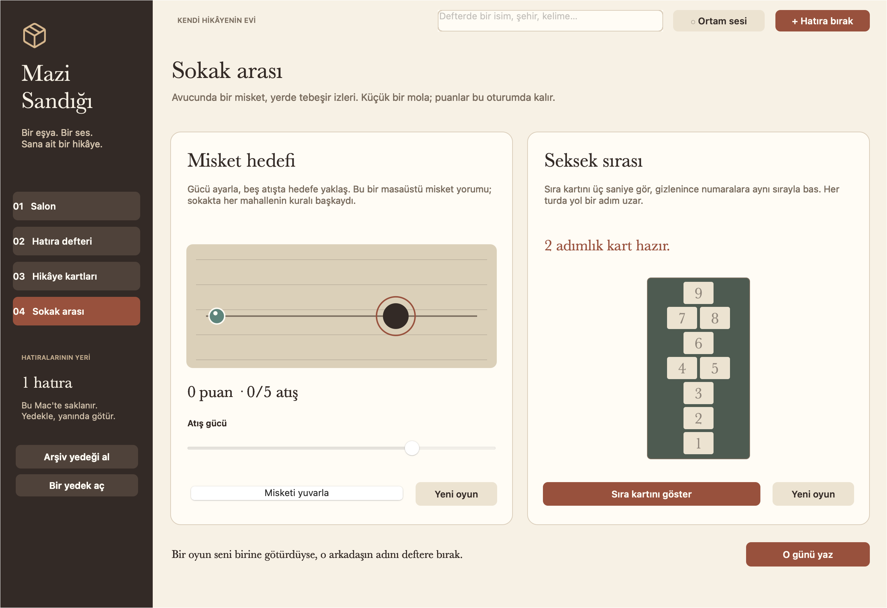

# Mazi Sandığı

**Bir eşya. Bir ses. Sana ait bir hikâye.**

Türkçe bir yerel macOS uygulaması: eski evlerin, mahallelerin, okul yıllarının ve ziyaretlerin izlerinden kişisel bir hatıra defteri kur. Dantelli televizyonu aç; bir program değil, o akşam odada kimlerin olduğunu hatırla.

**[Mac uygulamasını indir](https://github.com/metealpkarvan/mazi-sandigi/releases/latest)** · [English](README.en.md) · [Doğrulama](docs/VERIFICATION.md)

## Sandıkta ne var?

- **Resimli salon:** ince belli bardak, kaset, televizyon ve kolonya üzerinden açılan hatıra durakları. Özgün sıcak salon illüstrasyonu, kâğıt tonları ve kitap sayfasını andıran tipografi.
- **18 hatıra durağı, altı tema:** ev, mahalle, okul, bayram, yol ve sofra. Tema seçip kendi deneyiminle ilişkilendirebilirsin.
- **Fotoğraflı defter:** başlık, anlatı, yaklaşık yıl, yer ve kişiler. Bir kaydı düzenle, yıldızla veya sil. Türkçe karakterlere duyarlı, aksanlara toleranslı arama; on yıl ve yıldız süzgeçleri; eski/yeni sıralaması.
- **36 özgün hikâye sorusu:** birlikte oturup konuşmaya başlamak için. Soruyu kopyala veya cevabı bir hatıraya dönüştür. Otomatik ses kaydı ya da AI ile uydurulmuş aile hikâyeleri yok.
- **Kartpostal:** seçtiğin fotoğraf ve kısa anlatıyla PNG çıkar. Uzun metinlerde alıntı kısaltıldığı belirtilir; tam kayıt defter ve arşiv yedeğinde kalır.
- **Arşiv yanında:** metin ve fotoğrafları birlikte içeren .mazi yedeği; yazı için Markdown. Bir yedek açılırken önce kontrol edilir, ardından onay istenir; eski dosyanın geri dönüş kopyası korunur.
- **Sokak arası:** beş atışlık Misket Hedefi ve giderek uzayan Seksek Sırası. Bunlar sokak oyunlarından esinlenen masaüstü yorumlarıdır.
- **İsteğe bağlı ortam sesi:** düşük sesli yağmur dokusu ve saat tıkırtısı kodla üretilir. Varsayılan olarak kapalıdır; tek düğmeyle durur. İnternet radyosu veya telifli müzik kaydı içermez.

Her evin hatırası başka. Buradaki eşyalar kültürel çağrışımlar sunar; bütün Türkiye'nin aynı çocukluğu yaşadığı iddiasını taşımaz. Kişisel anlatılar tarihsel doğrulama değildir. [Kültür ve tasarım notları](docs/DESIGN.md) kaynakları ve seçimleri açıklar.

## İndir ve aç

**macOS 11 Big Sur veya sonrası. Intel x86_64 ve Apple Silicon arm64 için tek Universal uygulama.** Rosetta, Xcode, Swift kurulumu, hesap veya API anahtarı gerekmez.

1. Releases bölümünden MaziSandigi-v1.0.0-universal.zip dosyasını indir.
2. ZIP'i çıkar; Mazi Sandığı.app dosyasını Applications / Uygulamalar klasörüne taşı.
3. Uygulamayı aç. İlk açılışta boş bir defter gelir; kişisel veriler veya sahte eski kayıtlar yüklenmez.
4. Bir eşyaya dokunup “Bu hatırayı yaz”ı seç veya “Hatıra bırak” ile kendi anlatını yaz.
5. Yedek almak için “Arşiv yedeği al”ı kullan. Başka Mac'te “Bir yedek aç” ile devam et.

Paket bütünlüğü için **ad-hoc imzalıdır; Apple Developer ID imzası ve Apple notarizasyonu yoktur.** macOS ilk açılışı engelleyebilir. Önce açmayı dene; kaynağa güveniyorsan Sistem Ayarları → Gizlilik ve Güvenlik → Yine de Aç yolunu kullan. Eski macOS sürümlerinde aynı seçenek Sistem Tercihleri → Güvenlik ve Gizlilik altında bulunur. Gatekeeper'ı genel olarak kapatma. [Apple'ın açıklaması](https://support.apple.com/en-us/102445)

ZIP ve SHA256SUMS.txt dosyalarını aynı klasöre indirip bütünlüğü doğrulayabilirsin:

    shasum -a 256 -c SHA256SUMS.txt

## Defterin nasıl saklanır?

Uygulama çevrimdışı çalışır. Hesap, analitik, uzak sunucu veya senkronizasyon kullanmaz. Fotoğraflar yalnız dosya seçicisinden seçtiğin görsellerin kopyalarıdır; fotoğraf kitaplığını taramaz. Mikrofon izni istemez. GitHub yardım bağlantısı ancak sen açarsan tarayıcıya gider.

Kayıt dosyası:

    ~/Library/Application Support/MaziSandigi/hatiralar.json

Dosya düz JSON'dur ve fotoğraf kopyalarını da içerir; **şifreli değildir**. Yedek ve kartpostal kişisel bilgi içerebilir. Paylaşmadan önce içeriğini ve anlatan kişinin iznini gözden geçir. İşletim sistemi yedekleri, paylaşılan kullanıcı hesapları ve dosya erişim izinleri uygulamanın dışında kalır.

100 hatıra, en fazla 10 fotoğraflı kayıt, fotoğraf başına 2 MB ve arşiv için 30 MB sınırı vardır. Seçilen fotoğraf en uzun kenarı 1600 piksel olacak şekilde JPEG'e dönüştürülür; kaynak dosya değişmez. Metinler sessizce kesilmez; aşırı uzun kayıt kaydedilmeden bildirilir. Yıl bilinmiyorsa boş kalabilir.

Bozuk kayıt dosyası okunamazsa uygulama özgün dosyanın üstüne yazmaz ve düzenlemeyi kapatır. Dosya menüsünden klasörü açıp dosyayı kopyalayabilir veya sağlam bir yedeğe dönebilirsin. Geri dönüş kopyaları aynı klasörde geri-donus-…json adıyla saklanır; ihtiyacın kalmadığında dosya yöneticisinden kaldırabilirsin.

## Kısayollar

| Kısayol | İşlem |
| --- | --- |
| ⌘N | Yeni hatıra |
| ⌘F | Defterde ara |
| ⌘S | Arşiv yedeği al |
| ⌘O | Yedek aç |
| ⌘1 / ⌘2 / ⌘3 / ⌘4 | Dört bölüm arasında geç |
| ⌘Q | Çık; kaydedilmemiş hatıra için uyarı gelir |

Dosya → Kurmaca örnekleri ekle menüsü iki açıkça kurmaca kayıt ekler; mevcut hatıraları silmez.

## Ekranlar

[Hatıra yazma ekranı](docs/editor.png) · [Örnek kartpostal](docs/kartpostal.png)

## Kaynaktan çalıştır

Apple Command Line Tools, Swift 5.7+ ve macOS SDK'sı gerekir. Tam Xcode isteğe bağlıdır. Uygulama macOS 11'i hedefler; geliştirme makinesi kurulu araç zincirinin gereksinimlerini karşılamalıdır.

    git clone https://github.com/metealpkarvan/mazi-sandigi.git
    cd mazi-sandigi
    swift run -j 2 MaziRulesTests
    swift run -j 2 MaziSandigi

Çift mimarili paket:

    ./scripts/package.sh 1.0.0

Paketleme ayrı Intel/arm64 yürütülebilirlerini oluşturur, lipo ile birleştirir, kaynakları ve simgeyi ekler, imzayı ve mimarileri doğrular ve paketli uygulamayı kaynak dizininden bağımsız olarak kontrol eder. dist altında ZIP ve checksum dosyası oluşur.

[48 kural kontrolü ve AppKit doğrulaması](docs/VERIFICATION.md) · [Mimari](docs/ARCHITECTURE.md) · [Görsel üretim kaydı](docs/ARTWORK.md) · [Yol haritası](docs/ROADMAP.md) · [Katkı](CONTRIBUTING.md)

MIT © 2026 Mete Alp Karvan
